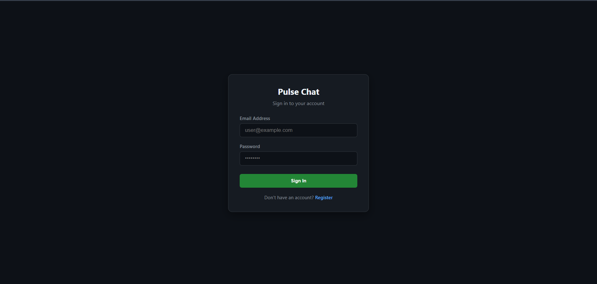
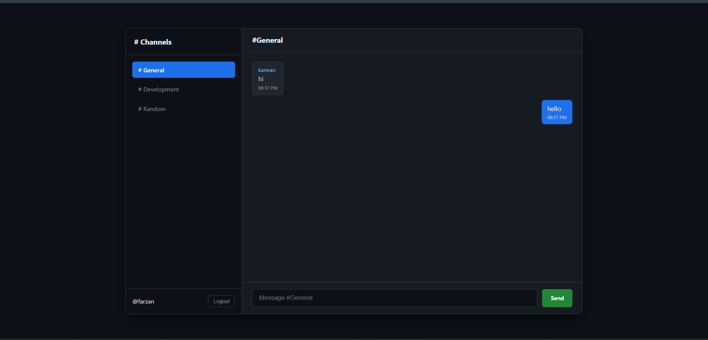

# Real-Time Pulse Chat Application

A modern, full-stack real-time messaging application built from scratch with React, Node.js, Express, Socket.io, and MongoDB Atlas.

---

## 📸 Screenshots

| Authentication Screen | Real-Time Chat Dashboard |
| :---: | :---: |
|  |  |

*(Or if you prefer them stacked vertically, you can use standard markdown:)*

### Authentication


### Real-Time Chat Room


---

## Features
- **Real-Time Communication**: Instant messaging powered by WebSockets (`Socket.io`).
- **Cloud Database Persistence**: Messages and user data securely stored in MongoDB Atlas.
- **Secure Authentication**: User registration and login with bcrypt password hashing and JSON Web Tokens (JWT).
- **Multi-Channel Navigation**: Easily switch between discussion rooms with automatic message history loading.
- **Responsive Dark UI**: Clean interface built with pure CSS.

---

## Tech Stack
- **Frontend**: React (Vite), Pure CSS, Socket.io-client
- **Backend**: Node.js, Express.js, Socket.io, Mongoose, JWT, bcryptjs
- **Database**: MongoDB Atlas

---

## Getting Started

### 1. Prerequisites
- Node.js (v18+)
- MongoDB Atlas cluster connection string

### 2. Backend Setup
```bash
cd backend
npm install
npm start